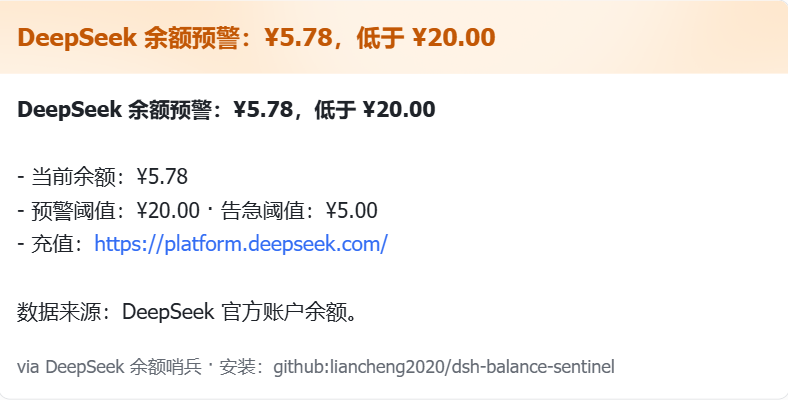

# dsh-balance-sentinel ｜ Balance Sentinel

[中文](README.md) | [English](README.en.md)

[](https://www.npmjs.com/package/dsh-balance-sentinel)
[](https://www.npmjs.com/package/dsh-balance-sentinel)
[](https://github.com/liancheng2020/dsh-balance-sentinel/actions/workflows/ci.yml)
[](https://github.com/liancheng2020/dsh-balance-sentinel/releases)
[](LICENSE)
[](https://github.com/liancheng2020/dsh-balance-sentinel#readme)

**DeepSeek balance running low? Get alerted in Feishu / DingTalk automatically.** Background monitoring that comes to you; **no API key to paste** on hosts with the built-in account service (sign-in required).

> **Three lines first**
> - Local DSH Desktop / local web host, **monitored only while DSH runs**; no remote web panel
> - Low balance pushes to Feishu / DingTalk; a top-up or threshold change sends one "recovered"/"resolved"
> - Paste a webhook in the panel → **Save and send test**; effective on save, one restart after install

**What you get** (the panel) and **a real alert** (Feishu card: critical red / warn orange / recovered green):

| Panel: balance + thresholds + channel | Low-balance alert push |
|---|---|
|  |  |

## Install

Requires DSH ≥ `0.2.1-rc.2`, Node ≥ 18.

```sh
# npm (recommended)
dsh plugin --profile web add dsh-balance-sentinel
# or straight from GitHub
dsh plugin --profile web add github:liancheng2020/dsh-balance-sentinel
# or the Release tarball
dsh plugin --profile web add https://github.com/liancheng2020/dsh-balance-sentinel/releases/download/v0.1.0/dsh-balance-sentinel-0.1.0.tgz
```

Desktop app: Settings → Plugins → add `dsh-balance-sentinel`. Restart DSH once.

## Support boundary

- **Local DSH Desktop / local web host**: monitoring runs inside the DSH process — quit DSH and it stops; reopening resumes from the local state file.
- **No remote web panel**: the panel uses the loopback bridge on `127.0.0.1:17430`, which only accepts pages from this machine.
- **No key needs the host account service and a signed-in DeepSeek account** (no key ≠ no account); otherwise use `DEEPSEEK_API_KEY` or `balance.apiKey` — with neither, the panel states the exact reason.

## First use (two steps)

1. Open the **Balance Sentinel** panel: your real balance immediately, or a clear reason (signed out / no account service / network…).
2. Pick a channel, paste the webhook (auto-detected) → **Save and send test**. The Feishu/DingTalk form includes "How to get a bot webhook": official doc + three-step path + the security settings that channel supports. **Until a channel is saved it watches without pushing**.

If the balance is already below a threshold when you connect, one current-state notice is sent (once).

## How it works

- **Two levels**: below 20 pushes "warn", below 5 pushes "critical" (account currency, panel-editable); a top-up or a threshold tweak back above warn pushes one "recovered"/"resolved" notice, effective immediately on save.
- **No spam**: same level never repeats; a real top-up pushes "recovered" (10-min anti-flap cooldown); a threshold tweak that resolves a delivered alert pushes "resolved" immediately; undelivered alerts cancel silently; quiet hours defer and merge into a single push afterwards.
- **No loss**: pending alerts persist; business failures back off 10 min and hold after 3 (manual retry in the panel); timeouts and dead response bodies are "delivery unconfirmed" — held immediately, never auto re-sent; a failed state save writes a fallback receipt, so restarts and multiple instances still do not re-send it (unconfirmed restores as held, never as sent). If neither the state nor the receipt can be written, the duplicate risk is logged explicitly.
- **No wedge, no duplicate across instances**: host queries have a 15s deadline and the scheduler survives any exception; desktop + web sharing `DSH_HOME` push each transition exactly once (whole-cycle lock + disk merge).
- **Channels**: WeCom / DingTalk / Feishu (card) / Bark / ServerChan / Telegram / generic webhook; auto-chunking; HTTP-200 business failures count as failures.
- Balance is the **official account number**; v1 ships no cost estimates.

## Config (optional, profile cordis.patch.yml)

```yaml
- id: balance-sentinel
  name: dsh-balance-sentinel
  config:
    balance:
      enabled: true
      pollSeconds: 60              # min 60
      warn: 20
      critical: 5
      timezone: Asia/Shanghai
      quiet: { start: "", end: "" }  # e.g. "23:00"–"08:00"
      apiKey: ""                   # fallback for older hosts only
    notify:
      signature: true              # "via 余额哨兵 · install: github:…" line, opt-out
      signatureText: ""
    localApi:
      enabled: true                # panel bridge on 127.0.0.1:17430
```

Thresholds and channel are also editable in the panel; saving applies without a restart.

## Privacy & compliance

- State and webhook live only in `$DSH_HOME/balance-sentinel/` (dir 0700). **No uploads, no telemetry by default.**
- The bridge binds 127.0.0.1 only, rejects cross-site origins and never exposes the webhook url/secret; balance queries use the host account service or the official `/user/balance` API, ≥60s interval, backoff on failure. MIT licensed.

## Feedback

Install or push problems? Open an [Issue](https://github.com/liancheng2020/dsh-balance-sentinel/issues) with DSH version / plugin version / OS / raw error.

Local verification: `node scripts/selftest.mjs`, `node scripts/selftest-client.mjs`, `node scripts/verify-dedup.mjs`, `node scripts/verify-market.mjs` (plain node, zero deps).

Same author: [AIHOT Radar](https://github.com/liancheng2020/dsh-aihot-radar) (quota-reset monitoring + AI news digest).
