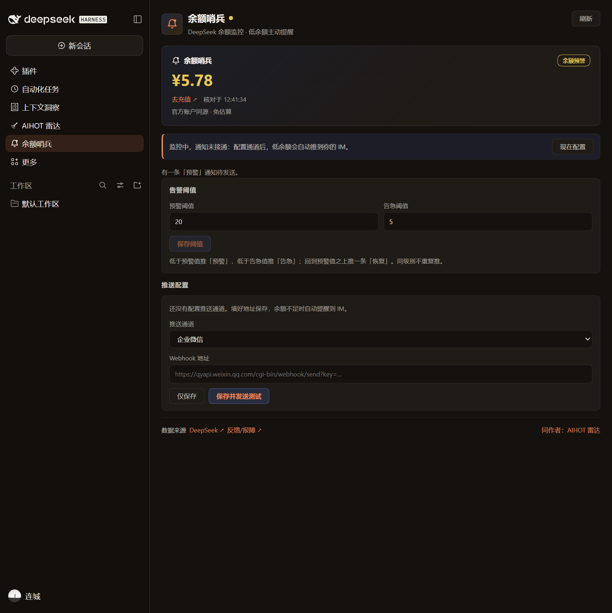

# dsh-balance-sentinel ｜ Balance Sentinel · DeepSeek balance alerts

[中文](README.md) | [English](README.en.md)

[](https://www.npmjs.com/package/dsh-balance-sentinel)
[](https://www.npmjs.com/package/dsh-balance-sentinel)
[](https://github.com/liancheng2020/dsh-balance-sentinel/actions/workflows/ci.yml)
[](https://github.com/liancheng2020/dsh-balance-sentinel/releases)
[](LICENSE)
[](https://github.com/liancheng2020/dsh-balance-sentinel#readme)

A DeepSeek Harness plugin: **DeepSeek balance monitoring** + **two-tier low-balance alerts pushed to Feishu / DingTalk and more** + **key-free on hosts with the built-in account service, zero runtime dependencies**

> **Three lines first**
> - **Monitored while DSH runs**, stops when it exits; no remote web panel
> - Low balance pushes to Feishu / DingTalk; a top-up or threshold change sends one "recovered"/"resolved"
> - Paste a webhook in the panel → **Save and send test**; effective on save, one restart after install

**What you get** (the panel) and **a real alert** (Feishu card: critical red / warn orange / recovered green):

| Panel: balance + thresholds + channel | Low-balance alert push |
|---|---|
|  |  |

## Install

Requires DSH ≥ `0.2.1-rc.2`, Node ≥ 18.

```sh
# straight from GitHub (works any time — start here)
dsh plugin --profile web add github:liancheng2020/dsh-balance-sentinel
# or npm (published to npm alongside each Release)
dsh plugin --profile web add dsh-balance-sentinel
# or the pinned Release tarball
dsh plugin --profile web add https://github.com/liancheng2020/dsh-balance-sentinel/releases/download/v0.1.5/dsh-balance-sentinel-0.1.5.tgz
```

Any one of the three is enough; if the npm/Release line is not live yet, use the first. Desktop app: Settings → Plugins → add `dsh-balance-sentinel` or `github:liancheng2020/dsh-balance-sentinel`. Restart DSH once.

**Where it runs**: local DSH desktop or local web host only — monitoring lives in the DSH process and **stops when DSH exits** (reopening resumes from the local state file); **no remote web panel** (the bridge binds `127.0.0.1:17430` and only accepts pages from this machine). **Key-free host accounts are supported**: the host must expose the account service with a signed-in account (key-free ≠ account-free); otherwise use `DEEPSEEK_API_KEY` or `balance.apiKey` — with neither, the panel states the exact reason.

> Current version `0.1.5` (see [CHANGELOG](CHANGELOG.md)).

## First use (two steps)

1. Open the **Balance Sentinel** panel: the official balance right away, or a clear reason (signed out / no account service / network…).
2. Click **Set it up**, pick a channel, paste the webhook (auto-detected) → **Save and send test**. The Feishu/DingTalk form links the official bot-webhook doc and that channel's security settings.

Until a channel is saved it watches without pushing. Saving only means "configured" — the badge turns into "last test succeeded" once a test push really lands, and "last test failed" (with the reason) when it does not; editing the channel clears the old result. If the balance is already below a threshold when you connect, one current-state notice is sent (once).

## How it works

- **Two levels**: below 20 pushes "warn", below 5 pushes "critical" (account currency, panel-editable); a top-up or a threshold tweak back above warn pushes one "recovered"/"resolved" notice.
- **No spam**: same level never repeats; recovery has a 10-min anti-flap cooldown; undelivered alerts cancel silently; quiet hours defer and merge into a single push.
- **Failures are traceable**: pending alerts persist; business failures back off 10 min and hold after 3 (manual retry in the panel); unconfirmed delivery is held immediately and never auto re-sent; only when even the receipt cannot be written is the duplicate risk logged.
- **No wedge, no duplicates**: host queries have a 15s deadline and the scheduler survives any exception; instances sharing `DSH_HOME` push each transition once (whole-cycle lock + disk merge).
- **Channels & look**: WeCom / DingTalk / Feishu (card) / Bark / ServerChan / Telegram / generic webhook; auto-chunking; HTTP-200 business failures count as failures; the panel follows the host light/dark skin.

Balance is the **official account number**; v1 ships no cost estimates.

## Config (optional, profile cordis.patch.yml)

```yaml
- id: balance-sentinel
  name: dsh-balance-sentinel
  config:
    balance:
      enabled: true
      pollSeconds: 60              # min 60
      warn: 20
      critical: 5                  # must be below warn; an inverted pair is swapped, an equal pair falls back to 20/5
      timezone: Asia/Shanghai
      quiet: { start: "", end: "" }  # e.g. "23:00"–"08:00"
      apiKey: ""                   # fallback for older hosts only
    notify:
      signatureText: ""            # optional custom footer; only appended when non-empty; truncated past 200 chars
      # signature: false           # optional explicit opt-out: never append, even with the text above
    localApi:
      enabled: true                # panel bridge on 127.0.0.1:17430
```

Thresholds and channel are also editable in the panel, so you never have to touch this file. The footer only ever comes from your own `signatureText` (no built-in install link, no panel switch); `signature: false` still turns it off explicitly.

## Privacy & compliance

- State and webhook live only in `$DSH_HOME/balance-sentinel/` (dir 0700). **No uploads, no telemetry by default.**
- The bridge binds 127.0.0.1 only, rejects cross-site origins and never exposes the webhook url/secret; balance queries use the host account service or the official `/user/balance` API, ≥60s interval, backoff on failure. MIT licensed.

## Feedback

Install or push problems? Open an [Issue](https://github.com/liancheng2020/dsh-balance-sentinel/issues) with DSH version / plugin version / OS / raw error.

Local verification: `node scripts/selftest.mjs`, `node scripts/selftest-client.mjs`, `node scripts/verify-dedup.mjs`, `node scripts/verify-market.mjs` (plain node, zero deps).

Same author: [AIHOT Radar](https://github.com/liancheng2020/dsh-aihot-radar) (quota-reset monitoring + AI news digest).
