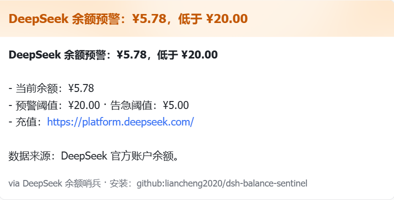
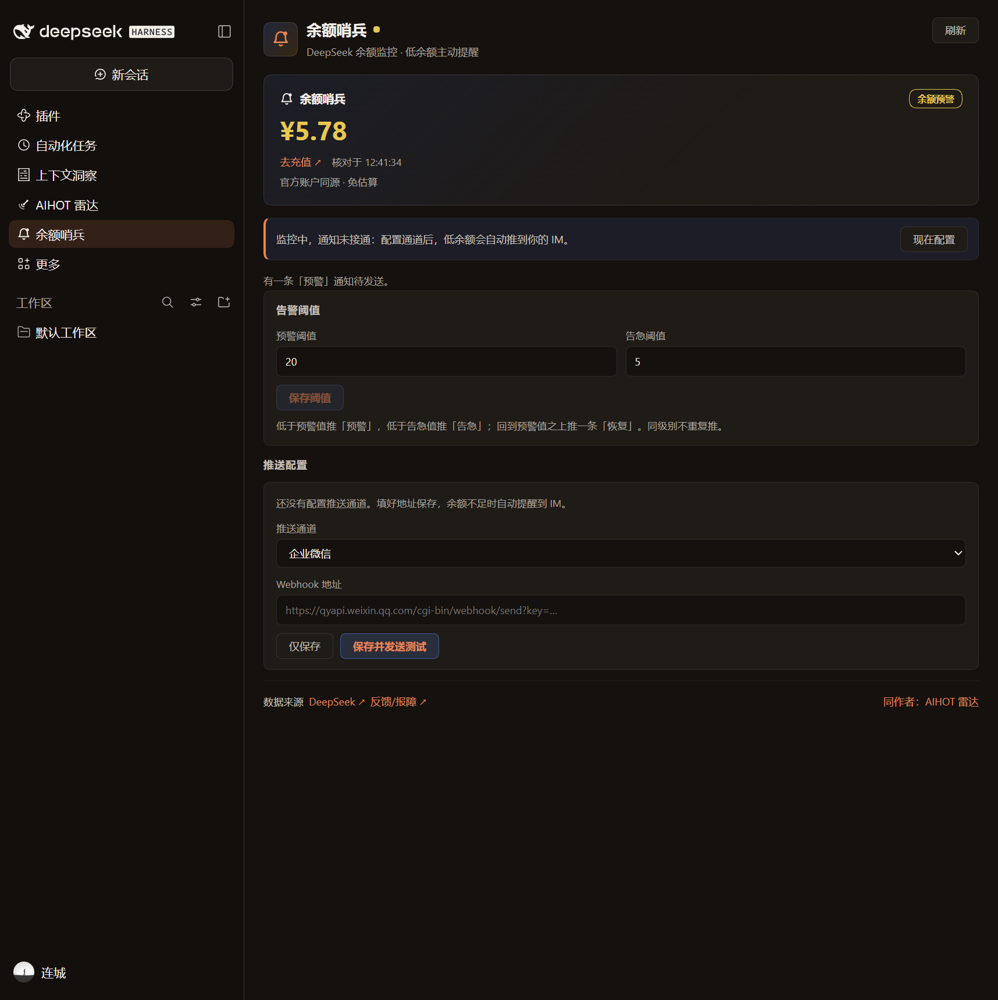

# dsh-balance-sentinel ｜ 余额哨兵

[中文](README.md) | [English](README.en.md)

[](https://www.npmjs.com/package/dsh-balance-sentinel)
[](https://www.npmjs.com/package/dsh-balance-sentinel)
[](https://github.com/liancheng2020/dsh-balance-sentinel/actions/workflows/ci.yml)
[](https://github.com/liancheng2020/dsh-balance-sentinel/releases)
[](LICENSE)
[](https://github.com/liancheng2020/dsh-balance-sentinel#readme)

**DeepSeek 余额不足，自动提醒到飞书／钉钉等 IM。** 后台监控、主动来找你——不是又一个要你盯着的余额展示牌。带官方账号服务的 DSH 宿主**免填 API Key**。

**真实告警长这样**（飞书卡片：告急红 / 预警橙 / 恢复绿）与面板首屏：

| 低余额告警推送 | 面板：余额 + 阈值 + 通道 |
|---|---|
|  |  |

## 安装

要求：DSH ≥ `0.2.1-rc.2`、Node ≥ 18。

```sh
# npm（推荐）
dsh plugin --profile web add dsh-balance-sentinel
# 或 GitHub 仓库直装
dsh plugin --profile web add github:liancheng2020/dsh-balance-sentinel
# 或 Release 直链
dsh plugin --profile web add https://github.com/liancheng2020/dsh-balance-sentinel/releases/download/v0.1.0/dsh-balance-sentinel-0.1.0.tgz
```

桌面端：设置 → 插件 → 添加插件，填 `dsh-balance-sentinel`。装完重启一次 DSH。

**兼容条件（免 Key 的边界）**：免 Key 依赖宿主内置账号服务（官方「设置 → 账号与余额」同源，**需已登录 DeepSeek 账户**——免 Key ≠ 无需账户）。本机桌面端实测可用；老宿主无该服务时自动回落 `DEEPSEEK_API_KEY` 环境变量或配置 `balance.apiKey`，仍无则面板给出明确原因，不静默失败。

## 首次使用（两步接通）

1. 打开 **余额哨兵** 面板：立即看到真实余额，或明确的不可用原因（未登录 / 无账号服务 / 网络…）。
2. 「推送配置」粘 webhook 地址（自动识别通道）→ **保存并发送测试** → 成功即接通。监控默认开着；**没配通道前只监控不推送**，横幅会清楚提示"通知未接通"。

接通时若余额已低于阈值，会补发一条当前状态通知（仅一次）。

## 它怎么工作

- **两级阈值**：默认低于 ¥20 推「预警」、低于 ¥5 推「告急」（账户币种，面板可改）；回到预警值之上推一条「恢复」。
- **不刷屏**：同级别停留不重推；「恢复」只由充值回升触发且有 10 分钟冷却防抖；调阈值或告警未送达时静默取消；免打扰时段顺延、出窗合并成一条。
- **不漏发**：待发送告警持久化；业务失败 10 分钟退避重试、3 次后挂起并在面板提供手动重试；超时等"送达不确定"最多补一次后标明未确认；新跃迁永远覆盖旧挂起。
- **多实例不重推**：desktop + web 共享 `DSH_HOME` 时，整周期锁 + 磁盘合并保证同一跃迁只推一次。
- **通道**：企微 / 钉钉 / 飞书（消息卡片）/ Bark / Server酱 / Telegram / 通用 Webhook；超长自动分条；HTTP 200 但业务失败同样判失败。
- 余额数字来自**官方账户同源**，v1 不做任何成本估算。

## 配置（可选，profile 的 cordis.patch.yml）

```yaml
- id: balance-sentinel
  name: dsh-balance-sentinel
  config:
    balance:
      enabled: true                # 关掉即停监控，面板仅展示
      pollSeconds: 60              # 最小 60
      warn: 20                     # 预警阈值（账户币种）
      critical: 5                  # 告急阈值
      timezone: Asia/Shanghai
      quiet: { start: "", end: "" }  # 免打扰，如 "23:00"–"08:00"
      apiKey: ""                   # 仅老宿主回落用；优先宿主账号/环境变量
    notify:
      signature: true              # 推送尾部短署名「via 余额哨兵」，可关
      signatureText: ""
    localApi:
      enabled: true                # 面板桥接 127.0.0.1:17430，可关
```

阈值与通道也可在面板里改，保存即生效，无需重启。

## 隐私与合规

- 状态与 webhook 仅存本机 `$DSH_HOME/balance-sentinel/`（目录 0700），**不上传、默认无遥测**。
- 本地桥接仅绑 127.0.0.1，跨站来源一律拒绝；只回 host 与余额，不暴露 webhook url/secret。
- 余额查询走宿主账号服务或 DeepSeek 官方 `/user/balance` 接口，60s+ 间隔、失败退避。
- 代码 MIT。

## 反馈

装不上或推送不通，请带 DSH 版本 / 插件版本 / 系统 / 报错原文到 [Issues](https://github.com/liancheng2020/dsh-balance-sentinel/issues)。

本地验证：`node scripts/selftest.mjs`、`node scripts/selftest-client.mjs`、`node scripts/verify-dedup.mjs`（纯 node、零依赖）。

同作者另一插件：[AIHOT 雷达](https://github.com/liancheng2020/dsh-aihot-radar)（额度重置监控 + AI 资讯日报）。